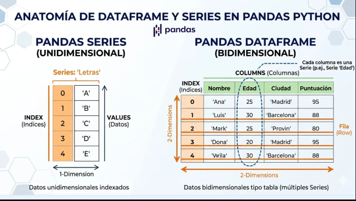
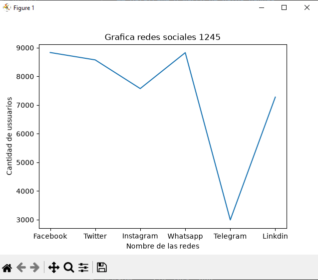
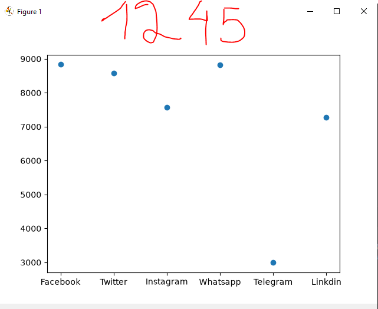
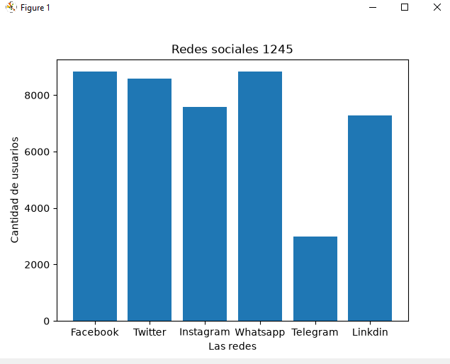
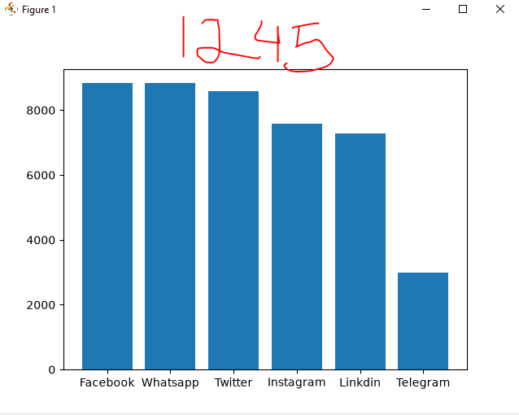
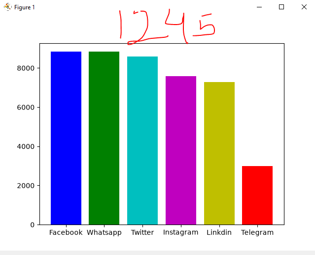
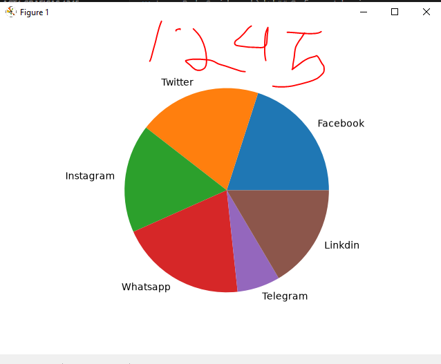

## Dataframe o Marco de datos pandas

## Redes sociales a nivel mundial

## Grafica lineal de redes sociales

## Grafica puntos de redes sociales

## Grafica de barras de redes sociales

## Grafica de barras del mas grande al chico Descendente

## Coloreando la grafica

## Grafica pastel o pie
